# Rushabh Singh

**Designing intelligent systems** &nbsp; · &nbsp; `think → build → ship`

I build AI products and the web apps around them. Lately I’ve been exploring how language models use tools, automating repetitive work, and turning research ideas into hackathon prototypes.

[Repositories](https://github.com/R1shabhCodes?tab=repositories) · [LinkedIn](https://www.linkedin.com/in/rushabh-singh22/) · [Email me](mailto:rushabhsingh2522@gmail.com)

## Toolbox

| What I’m working on | Tools I reach for |
| --- | --- |
| **Languages** |  |
| **Models & training** |  |
| **Interfaces & APIs** |  |
| **Data & deployment** |  |
| **Everyday tools** |  |

## Contribution arcade

Each square is a day on my GitHub calendar. Watch the snake eat its way through a year of commits, issues, and pull requests.

<picture>
  <source media="(prefers-color-scheme: dark)" srcset="https://raw.githubusercontent.com/R1shabhCodes/R1shabhCodes/profile-arcade/snake-contribution-graph-dark.svg">
  
</picture>

<details>
<summary><strong>Switch to Pac-Man</strong> · same calendar, four ghosts</summary>

<picture>
  <source media="(prefers-color-scheme: dark)" srcset="https://raw.githubusercontent.com/R1shabhCodes/R1shabhCodes/profile-arcade/pacman-contribution-graph-dark.svg">
  
</picture>

</details>

<details>
<summary><strong>One-line Python challenge</strong> · guess the output</summary>

What does this print after just one append?

```python
runs = [[]] * 3
runs[1].append("ship")
print(runs)
```

<details>
<summary>Reveal the answer</summary>

```python
[['ship'], ['ship'], ['ship']]
```

List multiplication repeats the reference to the same inner list. To give each run its own list, use `[[] for _ in range(3)]`.

</details>
</details>

## Workbench


I’m exploring generative AI, agent workflows, and MLOps. If you’re building an open-source AI tool or looking for a hackathon teammate, [drop me a line](mailto:rushabhsingh2522@gmail.com).

<details>
<summary><strong>GitHub activity & streak</strong></summary>


[Explore my contribution history on GitHub](https://github.com/R1shabhCodes#js-yearly-contributions)

</details>
