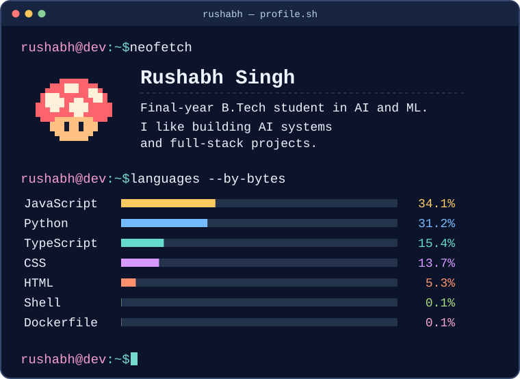

## Tech stack

## Contribution arcade

**Snake**

<picture>
  <source media="(prefers-color-scheme: dark)" srcset="https://raw.githubusercontent.com/R1shabhCodes/R1shabhCodes/profile-arcade/snake-contribution-graph-dark.svg">
  
</picture>

**Pac-Man**

<picture>
  <source media="(prefers-color-scheme: dark)" srcset="https://raw.githubusercontent.com/R1shabhCodes/R1shabhCodes/profile-arcade/pacman-contribution-graph-dark.svg">
  
</picture>

  
  

