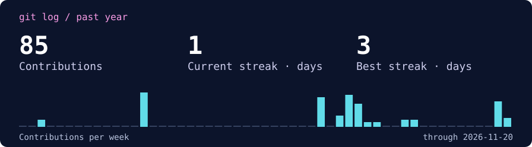

  

<h1 align="center"><code>&gt; Rushabh Singh_</code></h1>

<strong>AI engineering &nbsp; / &nbsp; full-stack development</strong>

I like the stretch between a model that works in a notebook and a tool someone can actually use. Right now I’m exploring language models, agent workflows, and hackathon builds.

  <a href="https://github.com/R1shabhCodes?tab=repositories"><b>Browse my code ↗</b></a> &nbsp; · &nbsp;
  <a href="https://www.linkedin.com/in/rushabh-singh22/">LinkedIn</a> &nbsp; · &nbsp;
  <a href="mailto:rushabhsingh2522@gmail.com">Email</a>

## Technology stack

<strong>Languages &amp; application development</strong>

<strong>Machine learning, data &amp; developer tools</strong>

## GitHub stats

## From my repositories

- [**Medical Data Visualizer**](https://github.com/R1shabhCodes/Medical-Data-Visualizer) · Explore health data with Python.
- [**Podcast Summarizer**](https://github.com/R1shabhCodes/Podcast_Summarizer) · A Python project for summarizing podcasts.
- [**Foodshare**](https://github.com/R1shabhCodes/foodshare) · A food donation website built with JavaScript.

## Contribution arcade

Each square is a day on my GitHub calendar. Watch the snake eat its way through a year of commits, issues, and pull requests.

<picture>
  <source media="(prefers-color-scheme: dark)" srcset="https://raw.githubusercontent.com/R1shabhCodes/R1shabhCodes/profile-arcade/snake-contribution-graph-dark.svg">
  
</picture>

<strong>Switch to Pac-Man</strong> · same calendar, four ghosts

<picture>
  <source media="(prefers-color-scheme: dark)" srcset="https://raw.githubusercontent.com/R1shabhCodes/R1shabhCodes/profile-arcade/pacman-contribution-graph-dark.svg">
  
</picture>

